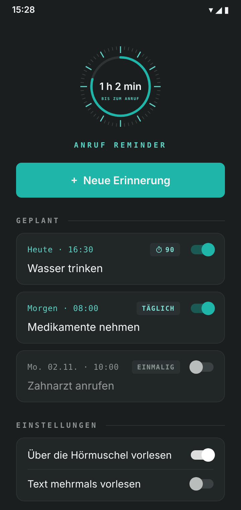
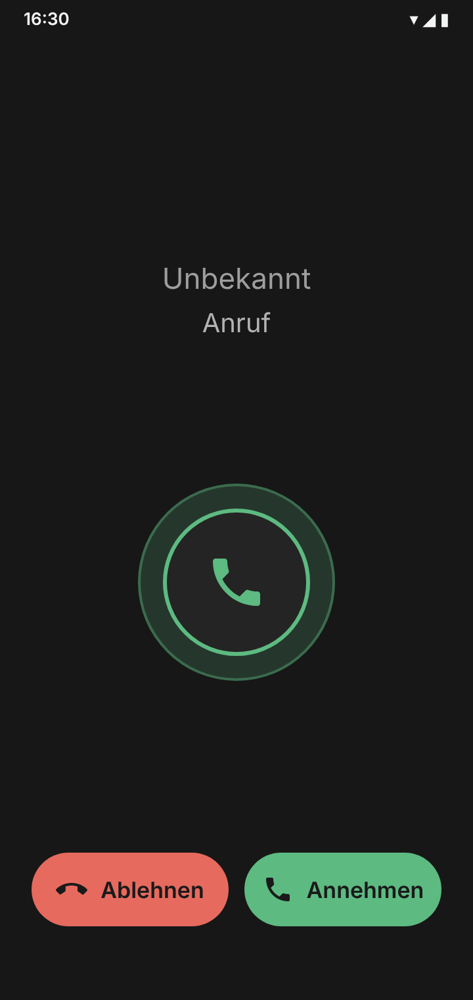
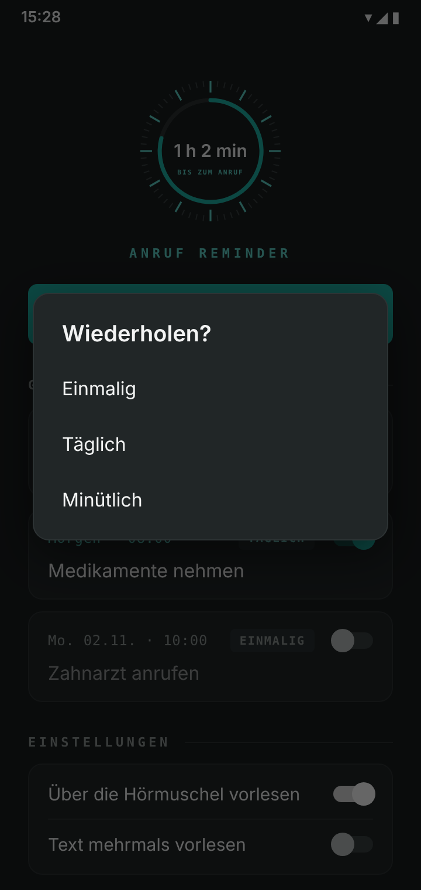

# Anruf Reminder

Android-App ohne Werbung, ohne Konto und ohne Internetzugriff: Zur eingestellten Zeit kommt ein simulierter Anruf. Nimmst du ab, wird deine Erinnerung per Text-to-Speech vorgelesen, wahlweise über die Hörmuschel wie bei einem echten Telefonat.

<p align="center">
  <a href="https://github.com/matijatasic/anrufreminder-/releases/latest/download/anruf-reminder.apk"></a>
</p>

<p align="center">
  
  
  
</p>
<p align="center"><sub>Abbildungen nachgestellt nach der App-Oberfläche (Version 1.0.42).</sub></p>

## Funktionen

- Erinnerung mit Titel (optional) und Text, Eingabe per Tastatur oder Diktat
- Datum und Uhrzeit, Wiederholung einmalig, täglich oder minütlich (alle X Minuten)
- Anruf auch bei gesperrtem Handy und geschlossener App
- Klingeln richtet sich nach dem Klingelmodus (normal, Vibration, lautlos), 15 Sekunden lang
- Vorlesen über Hörmuschel oder Lautsprecher (im Gespräch per Knopf umschaltbar), auf Wunsch in Schleife bis zum Auflegen
- Erinnerungen überstehen Neustarts
- Countdown bis zum nächsten Anruf auf der Startseite

## Installation

1. Auf dem Handy oben auf **APK herunterladen** tippen (lädt immer die neueste Version). Ältere Versionen gibt es unter [Releases](https://github.com/matijatasic/anrufreminder-/releases).
2. Datei öffnen und die Installation aus dieser Quelle einmalig erlauben. Fragt Play Protect nach, die App scannen lassen.
3. App öffnen und unter **Einrichtung** alle offenen Punkte antippen, bis überall ein Haken ist.
4. Eine Erinnerung in ein paar Minuten anlegen und das Handy sperren.

Bei Herstellern mit strenger Akku-Verwaltung (u. a. Samsung, Xiaomi, Huawei, Oppo, OnePlus, Vivo) öffnet die App direkt die passende Autostart-Einstellung und verlinkt die bebilderte Anleitung auf [dontkillmyapp.com](https://dontkillmyapp.com). „Beenden erzwingen“ in den App-Infos löscht unter Android alle Wecker einer App; danach die App einmal öffnen.

## Echtheit prüfen

Jede APK unter Releases ist mit demselben Schlüssel signiert. Der SHA-256-Fingerabdruck des Zertifikats lautet:

```
05:65:87:8C:9A:7F:29:BA:1B:44:56:F3:3C:99:5B:14:C7:68:88:DC:05:88:FD:3D:1E:5C:19:7F:FE:D3:06:97
```

In den Release-Notizen steht zusätzlich die SHA-256-Prüfsumme der APK-Datei. Unter Windows: `Get-FileHash anruf-reminder-….apk`, unter Linux/macOS: `sha256sum anruf-reminder-….apk`. Weicht etwas ab, die Datei nicht installieren.

## Datenschutz

Die App hat keine Internet-Berechtigung. Erinnerungen bleiben ausschließlich auf dem Gerät. Die Spracherkennung beim Diktieren übernimmt die Spracheingabe des Systems (z. B. Google).

## Bauen

Jeder Push baut die APK per GitHub Actions (`.github/workflows/build.yml`) und hängt sie an ein neues Release. Signiert wird mit einem Schlüssel aus den Repository-Secrets `KEYSTORE_BASE64` und `KEYSTORE_PASSWORD`; der Schlüssel liegt nicht im Repo. Lokal: `./gradlew assembleRelease` (Android SDK nötig, ergibt ohne Schlüssel eine unsignierte APK).

## Änderungen, Fehler, Sicherheit

- Was sich in welcher Version geändert hat: [`CHANGELOG.md`](CHANGELOG.md)
- Fehler melden: unter **Issues** die Vorlage „Fehler melden“ nutzen
- Sicherheitslücken bitte nicht öffentlich posten, sondern wie in [`SECURITY.md`](SECURITY.md) beschrieben melden

## Lizenz

MIT, siehe `LICENSE`. Ohne Gewähr: Die App ersetzt keinen Wecker für wichtige Termine.

Schriften: Inter (SIL OFL, `LICENSE-Inter.txt`), DejaVu Sans Mono (`LICENSE-DejaVu.txt`). Design angelehnt an [matija-tasic.de](https://github.com/matijatasic/matijatasic.github.io).
